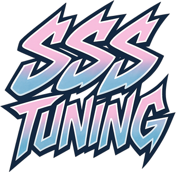
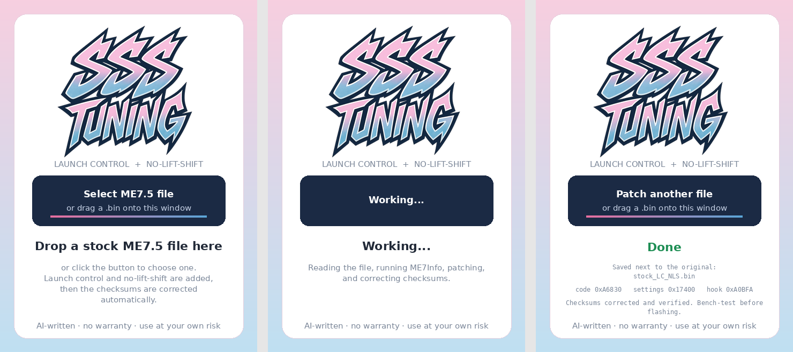

<p align="center">
  
</p>

<h1 align="center">ME7.5 Launch Control + No-Lift-Shift</h1>

<p align="center">
One-click launch control (2-step) and no-lift-shift for Bosch ME7.5 ECUs (VAG 1.8T).<br>
Select an original flash file and get back a patched file with checksums corrected and verified.
</p>

> [!WARNING]
> **Use at your own damn risk.** This program was written entirely by an AI (Claude). It comes with **no warranty**, and nobody involved is responsible for bricked ECUs, engine damage or anything else that goes wrong. Read [DISCLAIMER.md](DISCLAIMER.md) before using it.

<p align="center"></p>

---

## What it does

Adding launch control to an ME7.5 file normally takes four manual steps: run ME7Info in a command prompt to locate the RAM variables, run a PHP script with that output, open the result in ME7Sum to fix the checksums, and finally check that everything worked. This tool does all of it in one step:

1. **Checks the input file.** It must be a full 512 KB or 1024 KB flash, and its checksums must be valid. If they aren't, you're warned and can choose *Patch anyway*.
2. **Runs ME7Info** on the file to find the RAM addresses this software version uses (engine speed, vehicle speed, pedal, dwell time, battery voltage, clutch and brake switches).
3. **Injects the launch control / NLS routine** into an unused area of the flash. It hooks the routine into the ignition calculation and writes default settings.
4. **Corrects all checksums with ME7Sum**, then runs ME7Sum again to verify the result has 0 errors.
5. **Saves `<yourfile>_LC_NLS.bin`** next to the original. The original is never modified.

Everything runs locally. The exe is self-contained (ME7Info, ME7Sum and their definition files are embedded), so there's nothing to install and no internet connection is needed.

### How it behaves in the car

| Feature | Active when | What happens |
|---|---|---|
| **Launch control (2-step)** | Clutch pressed, car standing still (< ~3 km/h) | Ignition is cut above the launch RPM |
| **No-lift-shift** | Clutch pressed, brake **not** pressed, pedal above threshold, RPM above NLS threshold | Short ignition cut while you shift flat-foot |

## Usage

1. Download `ME7_LaunchControl.zip` from [Releases](../../releases) and unzip it.
2. Run `ME7_LaunchControl.exe`.
3. Click **Select ME7.5 file**, or drag a file onto the window or onto the exe. Files without an extension (e.g. `stock`) work too.
4. Flash the resulting `*_LC_NLS.bin`. **Bench-flash and test before driving.**

Windows SmartScreen may warn about the exe because it isn't code-signed. Click *More info → Run anyway*.

## Default settings

The tool writes the same defaults as the original script: 9 bytes at the **settings address** shown after patching. Normally this is in `0x17000–0x18000`. If that area is full, the settings go directly after the injected code, and the tool tells you.

| Offset | Size | Default (raw) | Meaning | Default value |
|---|---|---|---|---|
| +0 | word | `0x01A6` | Max vehicle speed for launch (`vfil_w`, ×0.0078125 km/h) | ~3.3 km/h |
| +2 | word | `0x4650` | Launch RPM limit (`nmot_w`, ×0.25) | 4500 rpm |
| +4 | word | `0x000A` | NLS cut length (routine cycles) | 10 |
| +6 | word | `0x55F0` | NLS minimum RPM (`nmot_w`, ×0.25) | 5500 rpm |
| +8 | byte | `0xE6` | NLS pedal threshold (`wped`, ×0.39 %) | ~90 % |

Words are little-endian. The meanings above were decoded from the injected code; double-check them against your own logs. If you edit these values, correct the checksums again afterwards (for example with ME7Sum).

## Compatibility

Tested on 22 ME7.5 files (1.8T, VW/Audi/Seat/Skoda). On 19 of them the patch applied and the checksums verified. "Tested" means the patch applied and ME7Sum validated the output. Only some of these files have actually been driven.

| Result | Software |
|---|---|
| ✅ Patched | 06A906032CL, HJ, HN, HS, MJ, TL · 4B0906018AR, CH, DC, DH, Q, R · 8E0909518, 8E0909518AK, 8E0909518AL · 8E0906018B (0261206868) |
| ⛔ Refused | 06A906032AR, 06A906032T, 4B0906018 (no suffix): the earliest 1999–2000 releases, where the ignition routine is laid out differently |

The tool **refuses** rather than guessing when:
- the hook instruction (`MOVB RL4, ub` before `EXTP #206h`) isn't found exactly once
- a required variable sits at an address the injected code can't reach
- the RAM used for the NLS counter (`0x384FF0`) is already used by the stock code
- the file already contains launch control
- the file size isn't 512 KB or 1024 KB

ME7.1 / ME7.1.1 files are not targeted. Some of them patch, but the code was written for ME7.5 and hasn't been tested on them.

### Differences from the original `launch.php`

On files the original handled correctly, `patch.go` produces **byte-identical output** (verified on three real ECU files). It is stricter in a few places:

- It finds the hook by the exact instruction it replaces, instead of "last occurrence of a byte pattern". On early 512 KB files the old method hooked the wrong routine.
- It supports 512 KB files, and it places the settings after the code when `0x17000–0x18000` is full.
- It validates addresses and bit offsets. The original silently wrote broken code for some layouts, including an encoding bug for clutch/brake bits at `0xFD00–0xFD1F`.
- It corrects and verifies checksums. The original left that to you.

The original script also zeroes one calibration byte it calls `FTOMN`. This tool does the same.

## Building

Requires Go 1.22+. Builds from Linux, macOS or Windows.

```bash
# 1. download the embedded tools (pinned versions, SHA-256 verified)
bash scripts/fetch-tools.sh        # or: powershell -File scripts\fetch-tools.ps1

# 2. run tests
go test ./...

# 3. optional: icon + version info for the exe
go install github.com/tc-hib/go-winres@v0.3.3
go-winres simply --arch 386 --manifest none --icon assets/icon.png

# 4. build
GOOS=windows GOARCH=386 go build -trimpath -ldflags "-s -w -H windowsgui" -o ME7_LaunchControl.exe .
```

GitHub Actions builds the exe on every push. Pushing a tag like `v1.0.0` publishes a release zip containing the exe and license files.

**Developer CLI (Linux/macOS):** `go build -o patchcli .` gives you `patchcli in.bin in.ecu out.bin`. It applies the patch using a `.ecu` file you generated with ME7Info, but it does **not** correct checksums.

### Project layout

```
patch.go          patch logic (platform independent, unit tested)
main_windows.go   Win32 GUI + pipeline (ME7Info -> patch -> ME7Sum)
cli_other.go      developer CLI for non-Windows builds
patch_test.go     tests on synthetic ECU images
scripts/          fetch-tools.sh / .ps1 + pinned hashes
third_party/      licenses of embedded tools
```

ECU files are never committed (`.gitignore` blocks `*.bin`, `*.ori`, `*.ecu`).

## Credits & licenses

- **launch.php**: the original launch control / NLS script from the ME7 community (NefMoto). The author is unknown; please open an issue if it's you.
- **ME7Info / ME7Logger** by mki (setzi62). Freeware for **non-commercial use only**. See [THIRD_PARTY.md](THIRD_PARTY.md).
- **ME7Sum** by 360trev and nyet. MIT license.

The source code in this repo is MIT-licensed ([LICENSE](LICENSE)). Release builds embed ME7Info, so **release builds may only be used and distributed non-commercially and free of charge.**

## Disclaimer

**This software is provided "AS IS", with no warranty of any kind. You use it entirely at your own damn risk.**

This program was written entirely by an AI (Claude, by Anthropic). It has been tested on a set of ECU files, but it has not been reviewed by a professional engineer, and it may contain bugs nobody has found yet.

The authors, contributors and SSS Tuning are **not responsible or liable** for any damage or loss from using it or the files it produces, including **bricked ECUs, engine, turbo, exhaust, catalytic converter or drivetrain damage**, damage to other electronics, accidents, failed inspections, fines, or voided warranties or insurance.

Ignition-cut launch control and NLS put extra heat and stress on the engine, turbo, exhaust and drivetrain by design. Always keep a backup of your original file, have a way to recover a bricked ECU, and bench-test before driving. "Checksums verified" does not mean "safe to flash". Making sure the modification is legal where you use it is your responsibility; it is intended for motorsport and off-road use.

Full text: [DISCLAIMER.md](DISCLAIMER.md). If you don't accept it, don't use the software.
